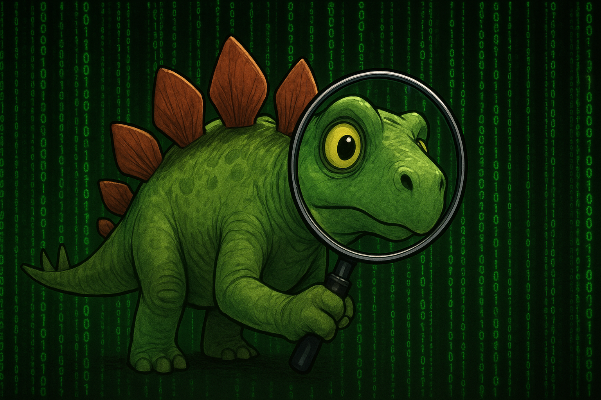

# Stegano

**Stegano** is a Windows desktop program that embeds messages in image
pixel data. A modified image may look unchanged during ordinary viewing, but
LSB steganography can be detected by analysis. A password can protect the
message contents; it does not guarantee that the image contains no hidden
data.

Encoding, decoding, and saved-password storage are handled locally and do
not require an internet connection. Opening a link in a message may launch
your default browser.

## Download

Grab the single-file program from the
[Releases page](https://github.com/Rockster001/stegano/releases/latest):
download **Stegano.exe** and double-click it. Nothing else is needed.

- **First launch takes 10–30 seconds.** A single-file program unpacks itself
  before it can start — that is normal, every launch after is the same.
- **Windows may show a blue "Windows protected your PC" warning** the first
  time you run it. This appears for any program that is not
  code-signed (a paid certificate aimed at companies). Click
  **More info → Run anyway**.
- On first run Stegano creates a folder **Documents\Stegano\Images** with a
  few starter pictures, so you have something to try immediately.

Stegano runs on Windows 10 and 11 (64-bit).

## How to use it

**Hiding a message (encoding)**

1. Click **Select Image** and pick a picture (any PNG or JPG).
2. Type your secret message.
3. Choose a password in **Pass 1** — or a **Pass 1 + Pass 2** pair for two
   separate layers — then save. The result is a new picture that contains
   your encrypted message.

**Reading a message (decoding)**

1. Open the picture that carries a message.
2. Type the password and press **Enter**. The hidden message appears.

**Reusing a previously used image**

1. Open the image with **Select Image**.
2. Click **Clear for Reuse**. This works without decoding messages or entering
   passwords.
3. Compose a new message and use the normal **Save** action.

Clear for Reuse resets the image's entire RGB least-significant-bit plane in
an internal temporary working copy. It does not create a user-visible
intermediate file, and it never changes the selected source file. The final
Save dialog opens in the source image's folder with no filename prefilled, so
you must choose a new name; saving over the source file is blocked. Since the
old pixel bits cannot be recovered, this does not restore the exact virgin
image or guarantee undetectability; the RGB channel values may each change by
at most one.

**Two layers, one picture**

- **Pass 1** reveals the first (outer) message.
- **Pass 2** reveals a second, independent message hidden inside the same
  picture. The two layers know nothing about each other: a person who
  decodes the outer message does not automatically see the second one.
- This is not a guarantee of undetectability or plausible deniability.
  LSB steganography and the file format may be detectable by analysis.
- Clicking between the Pass fields swaps which layer you are looking at
  (in decode mode), and deleting Pass 2 hides the inner layer again.

**Saved passwords**

Every password that decodes successfully is remembered (up to 10, newest
first) for convenience. On Windows, the list is protected with the current
user's Windows Data Protection API (DPAPI) credentials and is never written
into images. Existing saved passwords are migrated automatically. DPAPI
does not protect against someone who can use your logged-in Windows account
or run software as you. Do not save passwords that require stronger
protection. Double-click either Pass field to open the saved-passwords list.

## How it works and security limitations

- Newly encoded password-protected messages use **AES-GCM** with a
  password-derived key. This authenticates the encrypted data as well as
  protecting its contents. Older AES-CBC messages remain readable, but
  that legacy format does not authenticate changes to the message.
- Stegano processes images and messages locally; it does not upload them to
  an online service. Clicking a link inside a message may open it in your
  default browser.
- Encryption protects message contents; it does **not** make the presence
  of a hidden message impossible to detect.
- If anything ever goes wrong at startup, the details are written to
  **Documents\Stegano\crash.log** so the problem can be reported and fixed.

## Building it yourself

The repository is the complete source. To build your own **Stegano.exe** on
Windows, install Python 3.12 (64-bit) and double-click **build_exe.bat** in
the project folder. It creates a separate build environment, installs the
pinned libraries listed in **requirements-build.txt**, and produces
**dist\Stegano.exe**. The first build requires an internet connection to
download dependencies.

## License

Private project © 2026. All rights reserved.
